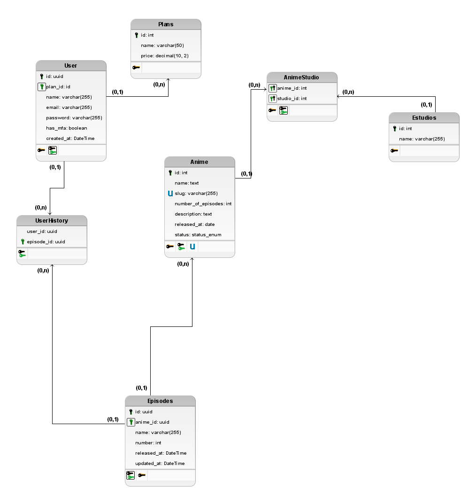

# Hikari

Anime streaming platform Hikari.

## What is this about ?

Hikari is a project to practice building a modern backend with good software development practices, such as 
unit testing, caching, using docker containers and more. All on Python's ecosystem. 

## Domain modeling

The domain modeling is described below using an entity relationship diagram.

